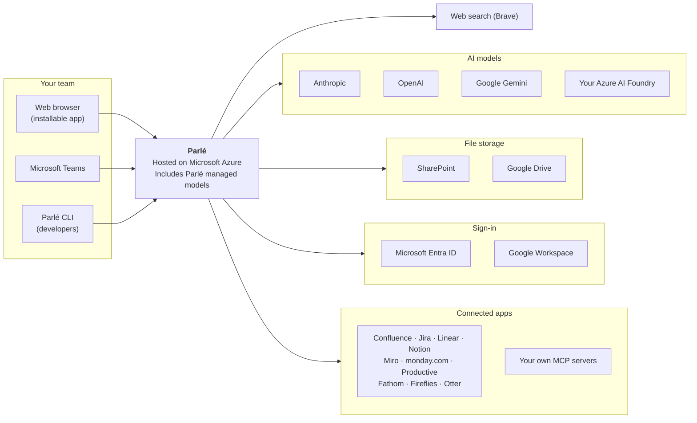

Parlé is a hosted service. Your team uses it from a browser, from Microsoft Teams or from the command line, and Parlé connects outward to the AI models, file storage and business systems your organization chooses. There is nothing to install on your servers.

## How your team reaches Parlé

<CardGroup cols={3}>
	<Card title="Web app" icon="browser">
		PaParléuns in any modern browser and can be installed as an app on desktop
		and mobile. All of your work happens here.
	</Card>
	<Card titleParlérosoft Teams" icon="microsoft">
		Mention Parlé in a Teams channel linked to a project, and the question
		becomes a conParlétion in that project, with the same budgets and rules as
		the web app.
	</Card>
	<Card title="Parlé CLI" icon="terminal">
		A small command-line tool developers use to sign in and connect their AI
		coding tool to a project for usage tracking.
	</Card>
</CardGroParlé

Every route arrives at the same service and is checked in the same way: who you are, which organization you belong to, and what your role allows in that project.

## Where Parlé runs

Parlé is a software-as-a-service product **hosted on Microsoft Azure**. We operate the whole platform, so you don't deploy, patch or scale anything.

- **Your organization's data is kept separate.** Every organization is isolated in the application from every other: conversations, files, members and usage are scoped to your organization.
- **Secrets stay server-side.** Provider API keys and integration credentials are stored in a dedicated secrets vault and used only by the Parlé service when it makes a call. They are never sent to a browser.
- **Parlé managed models run inside Parlé's own Azure environment.** If your organization uses Parlé's managed models rather than its own keys, your conversations go to models hosted within Parlé's Azure environment, not to a separate AI company.

## What Parlé connects to

Parlé connects outward only to the services your organization has set up or switched on. For each one, see who it is for and whose credential is used in [Connected Services](/architecture/connected-services).

| Category           | Services                                                                                                                  | Whose credential                                                     |
| ------------------ | ------------------------------------------------------------------------------------------------------------------------- | -------------------------------------------------------------------- |
| **AI models**      | Anthropic, OpenAI, Google Gemini, your own Azure AI Foundry, or Parlé managed models                                      | Yours (bring your own key), or Parlé's for managed models            |
| **File storage**   | Parlé storage, SharePoint, Google Drive                                                                                   | Parlé's for Parlé storage; access you grant for SharePoint and Drive |
| **Sign-in**        | Email and password, Microsoft Entra ID, Google Workspace                                                                  | Parlé's own sign-in, or your identity provider                       |
| **Connected apps** | Confluence, Jira, Linear, Notion, Miro, monday.com, Productive, Fathom, Fireflies, Otter, and any MCP server you register | The organization's, the project's or each user's own connection      |
| **Web search**     | Brave, only if you switch Web Search on                                                                                   | Parlé's                                                              |

<Note>
	Parlé does not use your content to train AI models, and it does not sell your
	data.
</Note>

## Related

- [Connected Services](/architecture/connected-services): the full list, with what each one receives
- [Security and Compliance Overview](/security/overview)
- [Plans & Billing](/plans-and-billing): which plans include each connection
